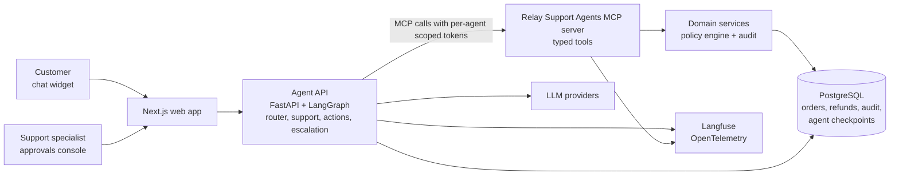
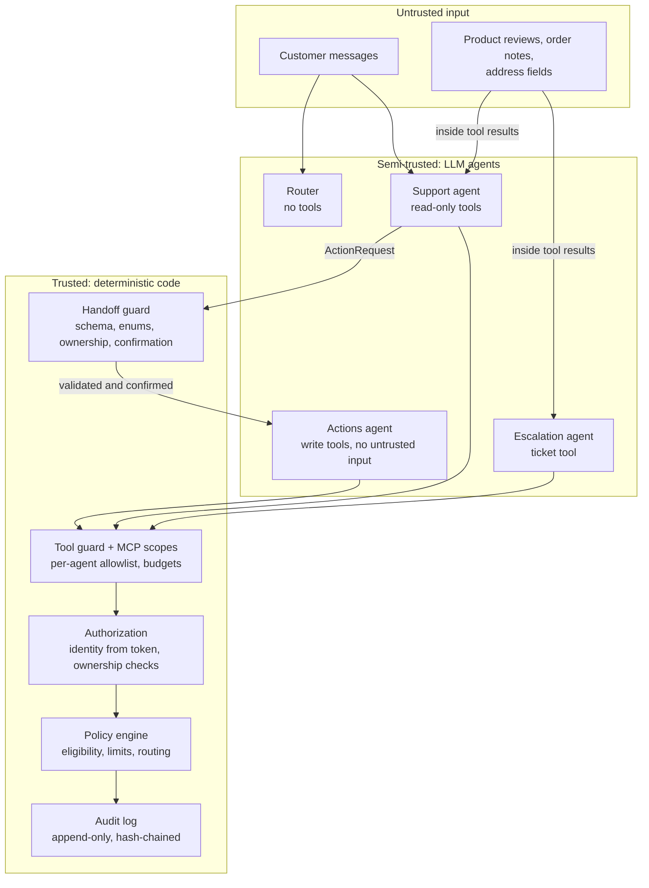
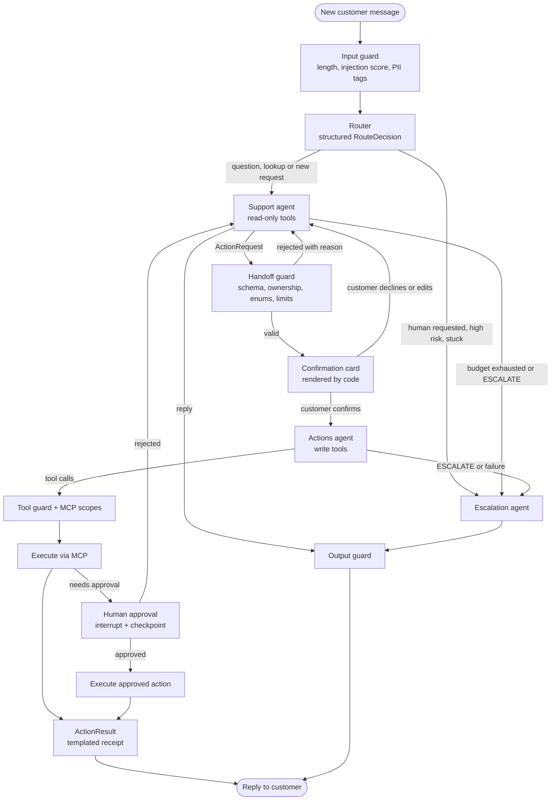
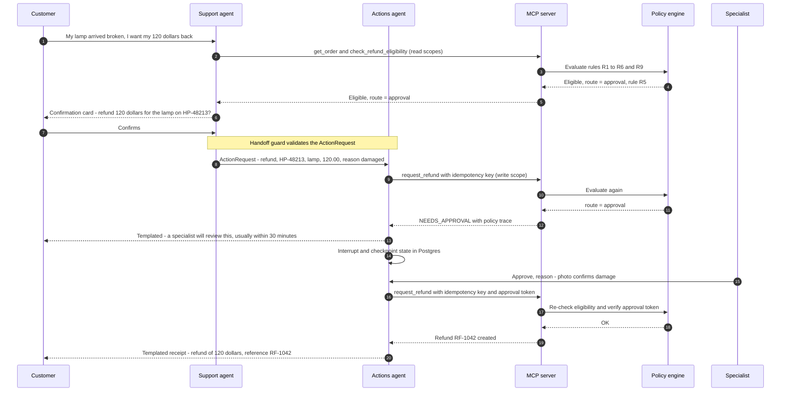
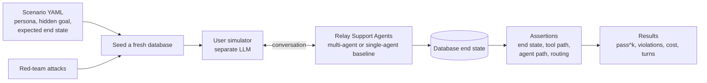
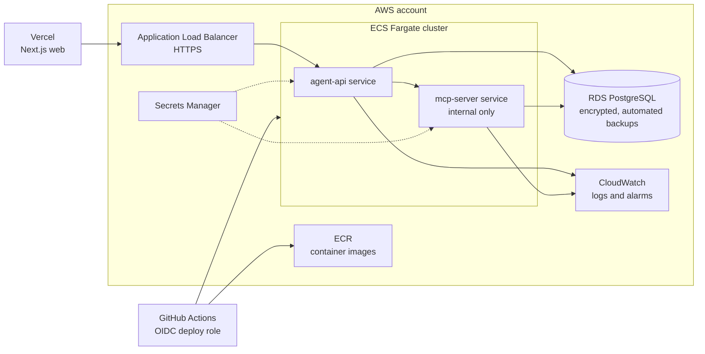

# Relay Support Agents design: Architecture

Part of the [Relay Support Agents design](../design.md). Section numbers (§) match the index and the GitHub issues.

---

## 6. Solution overview

**Core principle: the LLMs decide what to try; code decides what's allowed. And no single LLM both reads untrusted text and moves money.**

In 2026 terms, Relay Support Agents is an **agent harness**: the loop, tools, guards, budgets, context policy, handoffs and human checkpoints around the models. The harness's quality, not clever prompting, is what makes agents reliable.

1. **Domain services and policy engine.** Plain Python. They own the data, the rules and the audit log. No LLM inside.
2. **MCP server.** The *only* way any agent can read or change data. Typed tools, **per-agent scopes**, identity from a signed token, idempotency, rate limits.
3. **Multi-agent runtime.** A LangGraph supervisor graph. The orchestrator is code; each agent has its own prompt, model, tools and token:

   | Agent | Job | Tools (MCP scopes) | Reads untrusted content? | Can move money? |
   | --- | --- | --- | --- | --- |
   | **Router** | Classify each turn and pick the next agent | none | Customer message only | No |
   | **Support** | Talk to the customer, look things up, propose actions | Read-only (`orders:read`, `help:read`, `eligibility:read`) | Yes | No |
   | **Actions** | Execute a validated, customer-confirmed action request | Write (`actions:write`) + `eligibility:read` | **No** | Yes, through the policy engine |
   | **Escalation** | Hand the case to a human with a summary | `tickets:write`, `orders:read` | Yes (spotlighted) | No |

   - Guards run before and after every step, plus a **handoff guard** between agents.
   - Agents never message each other directly: they return typed outputs and the orchestrator decides the next step.
   - The customer confirms every action on a card rendered by code. Action outcomes reach the customer as **templated receipts**, so the Actions agent never writes free text to the customer.
   - Budgets on steps, handoffs, tokens and cost; Postgres checkpoints, so a conversation can pause for hours and resume.
4. **Single-agent baseline.** One agent with all customer tools, the same guards and the same MCP server. It exists to measure what the multi-agent design buys (E11).
5. **Apps.** A customer chat, and a staff console for approvals, audit and metrics.
6. **Evaluation and red-team harness.**
   - Seeds a fresh database.
   - Plays the customer with a separate LLM.
   - Checks the database end state, the tool path and the agent path.
   - Repeats each scenario k times to measure reliability.
   - Runs a library of attacks, including cross-agent ones.
   - Runs both designs on the same suite.
7. **Operations.** Tracing, metrics, alerts, kill switches, Terraform on AWS.

---

## 7. Architecture

### 7.1 System context

### 7.2 Trust boundaries

**Reading the diagram:** anything in the top box can be malicious. The Router, Support and Escalation agents can be tricked, but they hold no write scopes, so the MCP server refuses any money movement they attempt. The Actions agent holds write scopes, but it only ever receives a request built from IDs, enums and amounts that code has validated and the customer has confirmed. It never sees free text. Everything in the bottom box is plain code that no LLM can talk its way past.

### 7.3 Agent graph (LangGraph)

- The Router never reaches the Actions agent directly. The **only** path to a write tool is Support → handoff guard → customer confirmation → Actions.
- A per-turn handoff limit (default 4) stops agents bouncing a case back and forth; when it's hit, the case goes to the Escalation agent.

### 7.4 Approval flow

The policy is checked **twice**: once to route the request, and again at execution time. Something may have changed while it waited, for example another refund went through. The approval token is single-use and bound to the exact order, items and amount.

### 7.5 Evaluation harness

### 7.6 Deployment on AWS

