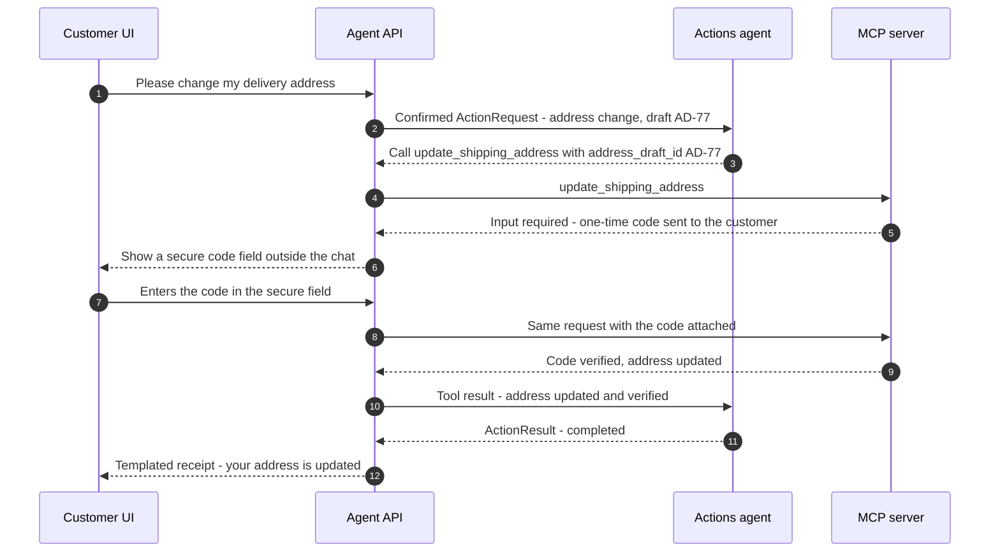

# Relay Support Agents design: Component design

Part of the [Relay Support Agents design](../design.md). Section numbers (§) match the index and the GitHub issues.

---

## 8. Component design

### 8.1 Commerce domain and seed data

- **Tables:** customers, addresses, products, orders, order_items, payments, shipments, refunds, approvals, store_credits, tickets, reviews, audit_log ([§9](04-data-api-stack.md#9-data-model)).
- **Seed generator** (Faker, fixed seed): 300 customers, about 1,500 orders and 200 products, reproducible with `make seed`.
- **Edge-case fixtures** that scenarios refer to by name:
  - delivered 29 days ago vs 31 days ago (R1 boundary);
  - order with a final-sale item (R2);
  - partially refunded order (R3);
  - order split into two shipments;
  - fraud-flagged customer (R6);
  - $900 order (R6);
  - placed vs shipped orders (R7);
  - goodwill credit used 30 days ago (R10);
  - customer with refunds totalling $45 in the last 24 hours (R4/R5 aggregate boundary);
  - **poisoned data:** product reviews, order notes and an address line containing injection payloads.

### 8.2 Policy engine

- Pure functions, no I/O, no LLM. Inputs are domain objects plus `now`; output is a decision with a trace. The full sketch is in [Appendix C](appendices.md#appendix-c-policy-engine-sketch).
- Rules live in `policies/2026-11-01.yaml` (limits, windows). Every decision records `policy_version` and the rule IDs that fired, which makes it auditable.
- Tests: **100% branch coverage**, plus property-based invariants (`hypothesis`):
  - a refund never exceeds paid minus refunded;
  - the 24-hour aggregate never exceeds a limit without approval;
  - no route other than `deny` for final-sale items.

### 8.3 MCP server (`relay-support-agents-mcp`)

| Tool | Type | MCP annotations | Scope | Used by | Notes |
| --- | --- | --- | --- | --- | --- |
| `get_customer_profile` | read | readOnly | `orders:read` | Support, Escalation | Identity comes from the token; masked email/phone |
| `list_orders` | read | readOnly | `orders:read` | Support | Own orders only; max 10; filters by status |
| `get_order` | read | readOnly | `orders:read` | Support, Escalation | Same `NOT_FOUND` error for "doesn't exist" and "not yours", which prevents enumeration |
| `get_shipment_tracking` | read | readOnly | `orders:read` | Support | Carrier status and ETA |
| `get_product_reviews` | read | readOnly | `help:read` | Support | **Returns untrusted text**, wrapped as data ([§8.5](#85-guards)) |
| `search_help_center` | read | readOnly | `help:read` | Support | Policy Q&A over help articles |
| `check_refund_eligibility` | read | readOnly | `eligibility:read` | Support, Actions | Calls the policy engine; returns the route and trace |
| `request_refund` | write | destructive, idempotent | `actions:write` | Actions | Needs an idempotency key; executes only if route = auto or a valid approval token is attached; otherwise creates a pending approval and returns `NEEDS_APPROVAL` |
| `cancel_order` | write | destructive, idempotent | `actions:write` | Actions | R7 |
| `update_shipping_address` | write | destructive, idempotent | `actions:write` | Actions | R8; takes an `address_draft_id`, never raw address text; the one-time code is collected through a secure input round trip, never through a model (see below) |
| `issue_store_credit` | write | destructive, idempotent | `actions:write` | Actions | R10 |
| `escalate_to_human` | write | idempotent | `tickets:write` | Escalation | Creates a ticket with the case summary |

**Replacements:** no tool creates a replacement. When a customer wants a replacement under R9, the case goes to the Escalation agent.

**Opaque references for free text:** when the customer types a new address, code validates it (schema, character allowlist, length) and stores it as an **address draft**. The Actions agent only ever handles the draft's ID, so customer-typed text never enters the money-moving agent's context.

**Identity design (the most important detail in this project):**

- The agent API authenticates the customer (a demo persona picker, standing in for real login), then mints a **short-lived signed token per agent**: JWT, 5 minutes, audience `relay-support-agents-mcp`, claims `customer_id`, `agent` and `scopes`.
- **Scopes per agent:** Router none; Support `orders:read help:read eligibility:read`; Actions `actions:write eligibility:read`; Escalation `tickets:write orders:read`.
- Each agent attaches its own token to every MCP request. The MCP server derives the customer from the token and **checks the scope on every call**, so even if a prompt tricks the Support agent into trying `request_refund`, the server refuses it.
- Each agent's MCP client loads only the tools its scopes allow, and the pinned tool hash is checked per agent.
- **No tool accepts `customer_id` as an argument.** The model can't pick whose data it touches.
- Admin tools (looking up any customer) live in a **separate** MCP server that the customer-facing agent never loads.

**Protocol (MCP 2026-07-28 revision; check the official changelog and your SDK's support):**

- **Stateless core:** no initialize handshake and no session-ID header, so the MCP service scales behind a plain load balancer. Application state (orders, approvals) still lives in Postgres: a stateless *protocol* doesn't mean a stateless *application*.
- **Transport:** Streamable HTTP, using the official MCP Python SDK.
- **Extensions:** Tasks (long-running work) and MCP Apps (interactive UIs) are versioned separately from the core. Both are stretch goals here ([§23](09-plan-and-risks.md#23-stretch-goals)).
- **Deprecated:** Roots, Sampling, Logging and the old HTTP+SSE transport are deprecated, so don't build on them.
- **Auth:** v1 uses the signed service token. **Stretch:** full MCP authorization (OAuth 2.1, hardened in this revision), so external clients like Claude Desktop or IDEs can connect to a public endpoint safely.

**Secure input design (one-time codes never touch the model):**

- When `update_shipping_address` needs the customer's one-time code, the server asks for it through the spec's Multi Round-Trip Requests (an input-required round trip). This revision uses that round trip in place of held-open elicitation streams.
- The agent API shows a dedicated code field in the chat UI and sends the code straight back to the server.
- The code is never added to the LLM context, so a manipulated model can't leak it or replay it.
- If your SDK doesn't support this flow yet, build the same pattern at your API layer: the tool returns `NEEDS_SECURE_INPUT` and the UI collects the value.



**Tool design rules:**

- **Descriptions are prompts.** Write when to use each tool *and when not to*.
- **Outputs:** structured JSON plus a one-line summary. Errors are codes (`NOT_FOUND`, `POLICY_DENIED`, `NEEDS_APPROVAL`, `ESCALATE`, `RATE_LIMITED`, `INVALID_ARGUMENT`) with a customer-safe reason.
- **Data minimization:** return only the fields needed (for example, the last 4 digits of the payment method, never full details).
- **Audit:** every call writes a record (actor, tool, args hash, result code, policy version).

**Tool-definition pinning:** the agent stores a hash of the expected tool list (names, schemas, descriptions). If the server's list changes unexpectedly, the agent refuses to start and alerts. This defends against "rug-pull" tool changes, and the same idea applies to third-party MCP servers.

**Sketch** (illustrative; check the current SDK docs):

```python
from mcp.server.fastmcp import FastMCP

mcp = FastMCP("relay-support-agents")

@mcp.tool()
async def get_order(order_id: str) -> dict:
    """Get one of the signed-in customer's orders: status, items, totals, delivery date.
    Use for status questions and before any refund or cancellation."""
    identity = current_identity()                  # our helper: verified token -> customer_id, agent, scopes
    identity.require_scope("orders:read")         # refuses agents without this scope
    order = await orders.get(order_id)
    if order is None or order.customer_id != identity.customer_id:
        return {"error": "NOT_FOUND"}              # identical for missing and not-owned
    await audit.record(identity, "get_order", {"order_id": order_id}, "OK")
    return order.to_public_dict()                  # minimized fields only
```

### 8.4 Multi-agent runtime (LangGraph)

- **Shape:** a supervisor graph. The orchestrator is code; the Router is a node; Support, Actions and Escalation are subgraphs, each with its own prompt, model, tool list and token. Agents don't call each other. They return typed outputs, and the orchestrator decides the next step (graph in [§7.3](02-architecture.md#73-agent-graph-langgraph)).
- **Shared state (`CaseState`), written only by code:** `conversation_id`, `customer_id` (from auth, read-only), `verified_order_ids` (IDs that tools returned for this customer), `pending_action` (an `ActionRequest`), `confirmation`, `pending_approval`, `risk_flags`, `handoff_count`, `step_count`, `cost_usd`, `kill_switch_state`, `case_summary`. Agents read a **view** of it ([§8.10](#810-context-engineering)); they can't write it directly.

| Agent | Default model (config) | Input | Output |
| --- | --- | --- | --- |
| Router | `claude-haiku-5-5` | Latest message, case summary, open state | `RouteDecision {next: support \| escalation, intent, reason}` |
| Support | `claude-opus-5-5` | Conversation (compacted), its tool results, case summary | A reply, or an `ActionRequest` |
| Actions | `claude-sonnet-5-5` | Validated, confirmed `ActionRequest` + verified facts | `ActionResult {status, reference, rule_ids, customer_safe_reason}` |
| Escalation | `claude-sonnet-5-5` | Case summary, transcript (tool data spotlighted), policy traces | `EscalationRequest` (ticket) + a handoff message |

Choose the final models per agent from ablation E6.

- **Handoff contract** (sketch; Pydantic v2):

  ```python
  class ActionRequest(BaseModel):
      model_config = ConfigDict(extra="forbid", frozen=True)
      action: Literal["refund", "cancel_order", "update_address", "store_credit"]
      order_id: str = Field(pattern=r"^HP-\d{5}$")
      item_ids: tuple[str, ...] = ()
      amount: Decimal | None = Field(default=None, gt=0, max_digits=10, decimal_places=2)
      reason: Literal["damaged", "missing", "not_as_described", "changed_mind", "late", "other"]
      address_draft_id: str | None = None   # opaque reference; never raw address text
  ```

  There is deliberately **no free-text field**. Anything the customer wrote stays with the Support agent and the approver's view.
- **Handoff guard (code):**
  - strict schema (unknown fields rejected);
  - `order_id` is in `verified_order_ids`; every item belongs to that order;
  - `amount` ≤ the refundable amount from the latest eligibility check;
  - one pending action at a time; the action is allowed in the current state;
  - on success, code renders the **confirmation card**; on failure, Support gets a structured "rejected: reason" and can recover;
  - every handoff (accepted or rejected) is written to `handoffs` and the audit log.
- **Customer confirmation:** the card shows the exact order, items, amount and action. The customer confirms with a button (or a clear "yes", which the Router sends back to code, not to an agent). Only then does the orchestrator start the Actions agent.
- **Action outcomes:** the Actions agent returns an `ActionResult`; the customer sees a **templated receipt**. The money-moving agent never writes free text to the customer.
- **Checkpointer:** Postgres. Every step is saved, so a conversation waiting on approval survives restarts and deploys.
- **Approvals:** inside the Actions subgraph, the `human_approval` node calls `interrupt(...)` with the approval request. The API resumes the graph with the specialist's decision. Sketch (illustrative; check the LangGraph docs):

  ```python
  from langgraph.types import Command, interrupt

  def human_approval(state: ActionsState) -> Command:
      req = state["pending_approval"]
      decision = interrupt({"approval_id": req.id, "action": req.action,
                            "amount": str(req.amount), "policy_trace": req.trace})
      if decision["approved"]:
          return Command(goto="execute_approved",
                         update={"approval_token": decision["token"]})
      return Command(goto="report_rejection",
                     update={"rejection_reason": decision["reason"]})

  # API, after the specialist decides:
  # graph.invoke(Command(resume=decision), config={"configurable": {"thread_id": conversation_id}})
  ```

- **Budgets:**
  - max 12 tool calls per customer turn (across all agents) and 40 per conversation;
  - max 4 handoffs per turn (stops agents bouncing a case back and forth);
  - max $0.50 per conversation (configurable);
  - 60 s wall clock per turn.
  - On exhaustion: hand to the Escalation agent; if that fails, send a fixed handoff message and create a ticket in code. Never loop.
- **Models:** IDs come from config, per agent. Compare models per agent in ablation E6, then choose from measured success and cost. A small model is usually enough for the Router.
- **Model API gotchas** (Anthropic, 2026):
  - The newest models reject forced tool choice (`any`/`tool`), so design the graph to work with `auto` and validate that a call (or a structured output) was produced when one is required.
  - Use `strict: true` tool schemas and structured outputs for `RouteDecision`, `ActionRequest` and `ActionResult`.
  - Sampling parameters like `temperature` are rejected on current API versions, so reliability comes from design and repeated-trial evals.
- **Tool loading:** use an MCP client adapter (for example `langchain-mcp-adapters`) per agent, loading only that agent's tools, then verify the agent's pinned tool hash.
- **Single-agent baseline (`agents/single/`):** one agent with every customer tool (one token with all customer scopes), the same input, tool and output guards, and the same confirmation card. It's the comparison point for E11, not a production mode: it runs only in evals (`AGENT_MODE=single`), never in the deployed demo, and it's the only code besides `agents/actions/` whose token holds `actions:write`.

### 8.5 Guards

| Guard | Checks | On failure |
| --- | --- | --- |
| **Input guard** | Max length (2,000 chars); rate limit; PII tagging for logs; prompt-injection classifier score (a small open-source classifier or a hosted guardrail API) | Never block on the classifier alone (false positives hurt real customers). A high score sets a `risk_flag` that forces approval for any money movement in this conversation |
| **Spotlighting** | All tool output is wrapped as `<tool_data source="product_review">…</tool_data>`, and the system prompt says such content is data, never instructions | Reduces indirect injection (measured in ablation E3) |
| **Tool guard** | Schema validation; tool allowed for this agent and in the current state (write tools only for a confirmed `ActionRequest`); duplicate-call detection (same tool + args twice); budgets; kill switch. The MCP server checks scopes again on its side | Return a structured "blocked: reason" to the agent so it can recover or escalate |
| **Handoff guard** | Strict `ActionRequest` schema; ownership of order and items; amount within the last eligibility result; no free text; one pending action; state allows the action | Reject with a structured reason back to the Support agent; record it in `handoffs` |
| **Output guard** | Applies to Support and Escalation replies (receipts are templates). No identifiers of other customers (order IDs, emails) that weren't returned for this customer; links only to the store's domain; no Markdown images (a data-exfiltration channel); max length | Rewrite or replace with a safe fallback and log a security event |

### 8.6 Approvals console and ops dashboard (Next.js)

- **Queue:** pending approvals with age, amount and risk flags; SLA timer (30 minutes); oldest first.
- **Detail view:**
  - transcript summary and full transcript (PII-masked);
  - order and payment facts;
  - **policy decision trace** (which rules fired);
  - risk signals (injection score, new account, refund history);
  - the agent path for the conversation (which agent proposed and executed the action);
  - approve or reject with a required reason.
- **Audit view:** filter by conversation, customer or tool; a verify-chain button ([§8.8](#88-tamper-evident-audit-log)).
- **Ops view:** containment, escalation and approval rates, queue time, tool error rate, guard triggers, cost per conversation, and the kill switches (with confirmation dialogs).
- **Auth:** staff login, separate from the customer flow (e.g. Auth.js or Supabase Auth). Every decision records the approver's identity.

### 8.7 Customer chat

- A demo persona picker (pre-seeded customers), because a public demo can't have real logins. The picker mints a session for that persona.
- Streaming replies; **action receipts** ("Refund RF-1042 for $24.99 submitted"); a "Talk to a human" button; an AI disclosure banner; a transcript download.
- An "Approval pending" state that updates live when the specialist decides ([§16.3](06-operations-and-cost.md#163-architecture-changes-by-tier) explains the delivery mechanism).

### 8.8 Tamper-evident audit log

- Append-only table. Each row stores `prev_hash` and `row_hash = SHA-256(prev_hash || canonical_json(payload))`.
- The database role used by the app has **INSERT and SELECT only** (no UPDATE/DELETE) on `audit_log`.
- `make verify-audit` recomputes the chain and reports the first broken link. Show this in the demo.

### 8.9 Observability

Details are in [§13](06-operations-and-cost.md#13-observability-and-operations).

- **One trace per conversation turn.** Spans: the router decision, each agent run, every handoff (with its validated payload and result), guard decisions, every LLM call (GenAI semantic conventions: model, input and output tokens), every tool call (name, result code, latency; arguments **redacted**), approval wait, budget usage.
- Exported via OpenTelemetry to Langfuse. Infrastructure logs and alarms go to CloudWatch.

### 8.10 Context engineering

What the model sees on every call is designed, budgeted and measured.

| Layer | Design |
| --- | --- |
| **Stable prefix per agent (cached)** | Each agent has its own system prompt (role, rules, policy *summary* where needed) + only its own tool definitions. Kept byte-identical: no timestamps or IDs, and tools always in the same order. Caching it lowers cost and speeds up the first token |
| **Just-in-time knowledge** | Full policy wording is fetched with `search_help_center` only when needed, instead of stuffing every policy into the prompt |
| **Tool results built for the model** | Minimal fields, consistent structure, short summaries, pagination for long lists, wrapped as `<tool_data>` (spotlighting) |
| **Mid-conversation operator instructions** | Notices like "write tools are disabled" are appended as system messages instead of editing the cached system prompt. Current Claude models support this, and it's the injection-safe operator channel |
| **Compaction** | After ~8 turns or ~20k tokens, older turns become a structured case summary (order IDs, decisions, pending approvals, verified facts). Facts needed for approvals and audit are never dropped |
| **Budget metrics** | Tokens per turn and cache-hit rate are tracked per agent in traces; ablation E10 measures the effect |

**Context view per agent** (what each agent is allowed to see):

| Agent | Sees | Never sees |
| --- | --- | --- |
| Router | Latest customer message, case summary, open state (pending action or approval) | Tool data, full history |
| Support | Compacted conversation, its own tool results (spotlighted), case summary | Other customers' data, approval tokens, one-time codes |
| Actions | The validated `ActionRequest`, verified facts from code, its own tool results | Customer messages, reviews, order notes, any free text |
| Escalation | Case summary, transcript with tool data spotlighted, policy traces | Approval tokens, one-time codes |
