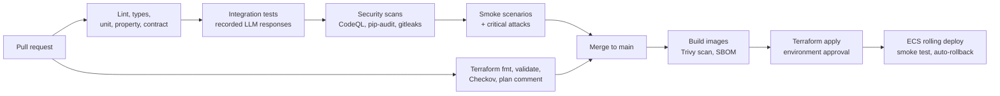

# Relay Support Agents design: Testing, repository and CI/CD

Part of the [Relay Support Agents design](../design.md). Section numbers (§) match the index and the GitHub issues.

---

## 19. Testing strategy

| Level | What |
| --- | --- |
| Unit | Policy engine (100% branch coverage), guards (including the handoff guard), handoff contracts, token minting/validation and scopes, audit chain, cost calculator |
| Property-based | Policy invariants ([§8.2](03-components.md#82-policy-engine)); idempotency (same key → same result) |
| Contract | Per-agent MCP tool list snapshots and handoff schema snapshots to catch accidental changes; OpenAPI for the REST API |
| Integration | Orchestrator ↔ agents ↔ MCP ↔ Postgres with **recorded LLM responses** (deterministic, free); a write call with a read-only token is rejected |
| End-to-end | Playwright: chat → confirmation card → refund over $50 → approve in console → receipt appears in chat |
| Evals | Scenario suite + red-team (cost-incurring, tagged) |
| Load | k6 with a mocked LLM: 100 concurrent SSE conversations against staging (tests your infra, not the provider) |
| Chaos (could-have) | Kill the MCP task mid-conversation; restart the API during a pending approval, then verify resume |

---

## 20. Repository structure

```text
relay-support-agents/
├── README.md  LICENSE  AGENTS.md  CLAUDE.md  Makefile  pyproject.toml  uv.lock
├── CONTRIBUTING.md  SECURITY.md  CODE_OF_CONDUCT.md  CHANGELOG.md  VERSIONING.md  TODO.md
├── BRANCH_NAMING_GUIDELINES.md  COMMIT_MESSAGE_GUIDELINES.md  PULL_REQUEST_GUIDELINES.md
├── .markdownlint.jsonc
├── .github/                      # workflows/, ISSUE_TEMPLATE/, PULL_REQUEST_TEMPLATE.md, CODEOWNERS
├── docker-compose.yml            # postgres, api, mcp, web (local)
├── .env.example
├── policies/
│   ├── 2026-11-01.yaml           # limits, windows
│   └── POLICY.md                 # human-readable rules R1–R12
├── src/relay_support_agents/
│   ├── domain/        (models.py, policy.py, services/, audit.py, idempotency.py)
│   ├── mcp_server/    (server.py, tools/, auth.py, ratelimit.py)
│   ├── agents/
│   │   ├── orchestrator.py  state.py  handoff.py   # graph, CaseState, contracts + handoff guard
│   │   ├── router/  support/  actions/  escalation/  # one package per agent: prompt, model config, tools
│   │   ├── single/                                   # single-agent baseline (E11)
│   │   ├── guards/        (input.py, tool.py, output.py)
│   │   └── mcp_client.py  budgets.py  pinning.py  templates.py
│   ├── api/           (main.py, routes/{conversations,approvals,admin,privacy}.py, sse.py, auth.py, notify.py)
│   ├── llm/           (interface, pricing, usage tracking)
│   ├── observability/ (tracing.py, redaction.py)
│   └── db/            (migrations/, seed/{generator.py, fixtures/})
├── evals/
│   ├── scenarios/     (happy/, policy_edges/, clarification/, escalation/, multi_intent/, handoffs/)
│   ├── redteam/       (attacks/*.yaml, promptfooconfig.yaml)
│   ├── baselines/e0/  # deliberately unsafe E0 baseline (eval-only, never shipped)
│   ├── simulator/prompt.md
│   ├── judges/        (communication_rubric.md, calibration/)
│   ├── run.py  grade.py  passk.py  report.py  thresholds.yaml
│   └── reports/
├── web/                          # Next.js: /chat and /console
├── infra/terraform/
│   ├── modules/       (network, ecs_service, rds, alb, secrets, github_oidc, observability)
│   └── envs/demo/     (main.tf, variables.tf, backend.tf)
├── tests/             (unit/, property/, contract/, integration/, e2e/, load/)
└── docs/
    ├── design.md  design/  engineering-standards.md
    ├── threat-model.md  redteam-report.md  error-analysis.md
    ├── runbook.md  privacy.md  system-card.md  build-log.md
    └── adr/
```

---

## 21. CI/CD and infrastructure as code



- **Workflows:**
  - `ci.yml`
  - `evals.yml` (PR smoke + critical attacks)
  - `nightly.yml` (scheduled twice a week: full k = 4 + full red-team)
  - `terraform.yml` (plan on PR as a comment; apply on `main` behind a GitHub Environment with required approval)
  - `deploy.yml`
- **Auth to AWS:** `aws-actions/configure-aws-credentials` with `role-to-assume` (OIDC). There are no access keys in GitHub secrets.
- **Terraform state:** S3 backend with locking. Keep it in a separate bootstrap stack.
- **Deploy safety:** ECS deployment circuit breaker with rollback, and a post-deploy smoke test that runs 3 scenarios against the live stack.
